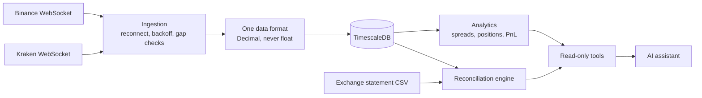

<div align="center">

# DeskPilot

**An AI back office for a crypto trading desk.**
Live exchange data in, verified numbers out, and an assistant that is never allowed to do the maths.


</div>

---

## The problem

A small trading desk spreads across several exchanges. Prices live on different screens in different formats, someone reconciles trades against statements by hand every evening, and a plain AI will confidently invent a profit figure. DeskPilot removes the manual work without trusting the model with any money.

## How it works



- **Ears.** Live prices from several exchanges, normalised into one format, with automatic reconnects.
- **Notebook.** Every price and trade is stored once, exactly, with idempotent writes.
- **Checker.** Compares the ledger with an exchange statement and flags missing trades and differences in quantity, price, fee and time.
- **Assistant.** Answers questions by calling typed, read-only tools. Code calculates; the model only explains.

## Design rules

- Money is `Decimal` end to end. No floats.
- The model never computes a number. Tools return finished values as text, and the model copies them.
- Tool arguments are typed and strict. Unknown arguments are rejected.
- File names from the model are untrusted: plain `.csv` names inside one folder only.
- No write tools exist. The assistant cannot trade or edit records.
- Plain OpenAI SDK against any OpenAI-compatible provider. No agent framework.

## Evaluation

The assistant is scored on **30 golden questions** with answers worked out by hand from fixed data. Each answer must call the right tools, contain the right numbers, and contain **no number that is not in the question or a tool result**. That last check is what catches the model doing arithmetic on its own.

- Model: `openai/gpt-oss-120b` on Groq, temperature 0
- First run: **19/30**. Latest run: **27/30**
- The real failure it caught: asked for a position's market value, the model multiplied by itself and answered 22018.35 instead of 22018.50

Full breakdown in [`docs/eval-results.md`](docs/eval-results.md).

## Quick start

```bash
git clone https://github.com/<you>/deskpilot && cd deskpilot
uv sync
cp .env.example .env          # add LLM_API_KEY and LLM_MODEL

make db-up && make migrate
uv run python scripts/seed_trades.py

uv run python scripts/ask.py "How much realized profit did we make on 2026-11-10?"
```

More:

```bash
uv run python scripts/reconcile.py data/statements/binance_2026-11-10.csv \
  --exchange binance --start 2026-11-10 --end 2026-11-11

uv run python scripts/inject_breaks.py     # plant known errors, check every one is found
uv run python scripts/run_evals.py --write # score the assistant
make test
```

## Project layout

```
src/deskpilot/
  ingestion/   exchange feeds, reconnect and backoff
  models/      one shape for prices and trades
  storage/     TimescaleDB repositories and migrations
  analytics/   spreads, positions, profit and loss
  recon/       statement loader and reconciliation engine
  agent/       tool registry, tools, tool-calling loop
  evals/       golden questions and scoring
tests/         unit, integration, fault injection, reconciliation
docs/          design decisions and eval results
```

## Decisions

Why Decimal, why plain SDK tool calling, why read-only tools, and what changes at scale are written up in [`docs/decisions.md`](docs/decisions.md).